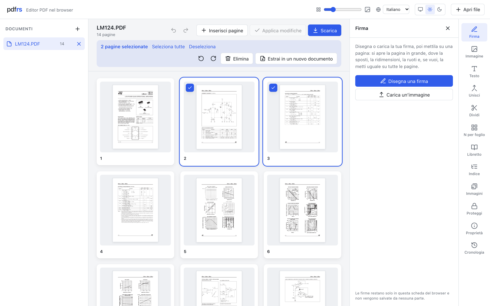
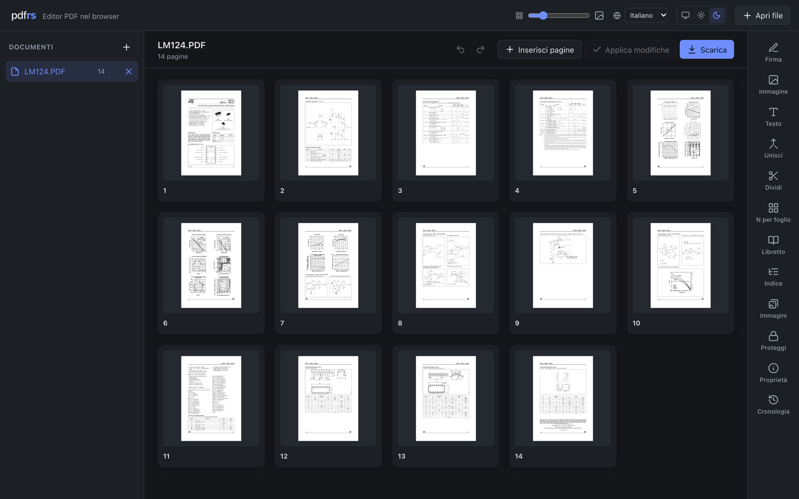
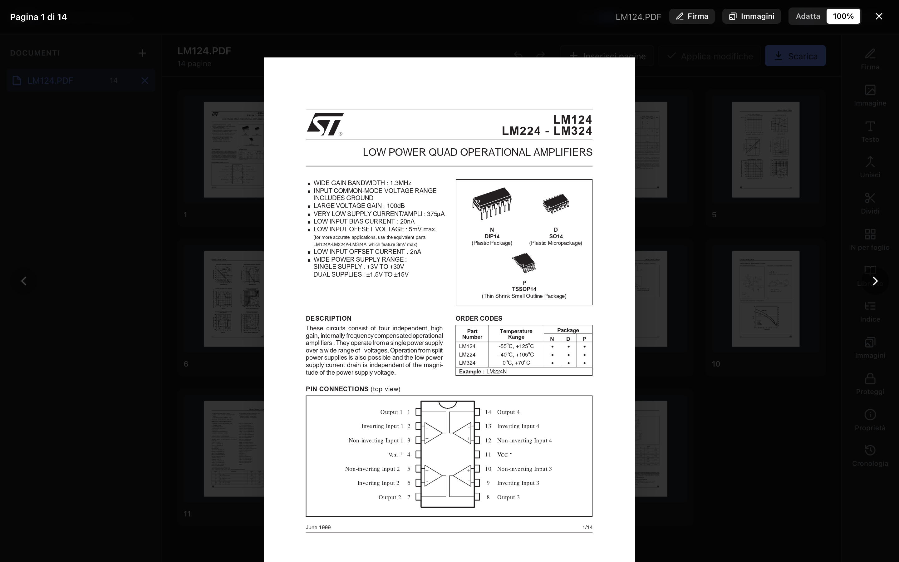

<p align="center">
  
</p>

<h1 align="center">pdfrs</h1>

<p align="center">
  <strong>Editor PDF che gira interamente nel browser.</strong><br>
  Niente da installare, nessun file caricato su un server, funziona anche offline.
</p>

<p align="center">
  <a href="https://teo666.github.io/pdfrs-app/"><strong>▶ Provalo subito</strong></a>
  &nbsp;·&nbsp;
  <a href="../../releases/latest">Estensione per Chrome, Edge e Firefox</a>
  &nbsp;·&nbsp;
  <a href="#sviluppo">Sviluppo</a>
</p>

<p align="center">
  
</p>

<p align="center">
  
  &nbsp;
  
</p>

<p align="center"><sub>Screenshot generati con <code>node scripts/make-screenshots.mjs documento.pdf</code>.</sub></p>

## Perché pdfrs

- **I file restano sul tuo computer.** Ogni operazione la fa un motore scritto in Rust e compilato in WebAssembly, dentro la pagina. Non c'è un server che riceve i PDF, non ci sono account né tracciamento.
- **Niente da installare.** Basta aprire la pagina. Se vuoi, c'è anche l'estensione per il browser.
- **Funziona offline.** Dopo la prima visita l'app resta nel browser e si apre anche senza rete. L'estensione funziona offline da subito.
- **Veloce anche con documenti grandi.** Le miniature si generano in parallelo su un pool di Web Worker, solo quando entrano nello schermo, e la griglia resta fluida anche con migliaia di pagine.
- **In cinque lingue**: italiano, inglese, spagnolo, tedesco, francese. Tema chiaro, scuro o automatico.

## Cosa fa

**Pagine**
- Apre più PDF e JPEG, scelti dal pulsante o trascinati in qualsiasi punto della finestra.
- Ruota, elimina e riordina le pagine trascinandole.
- Selezione con clic, ⇧+clic e ⌘/Ctrl+A, poi operazioni su tutto il gruppo.
- Estrae pagine in un nuovo documento.
- Sposta o copia pagine tra documenti trascinandole sul loro nome.
- Inserisce le pagine di un altro file, o una pagina bianca della misura di quella accanto.
- Una foto diventa una pagina A4, Letter o delle sue misure, con il margine che scegli.

**Strumenti**
- **Firma**: disegnata con mouse o dito, oppure caricata da un'immagine (lo sfondo bianco diventa trasparente). Si sposta, si ridimensiona, si ruota, e si può mettere uguale su tutte le pagine.
- **Immagine e testo** sopra le pagine. Il testo è vero, selezionabile e ricercabile nel PDF, scritto con i font standard.
- **Filigrana**: «BOZZA», «RISERVATO» o quello che vuoi su tutte le pagine o su quelle scelte, adattata alla pagina o della dimensione che vuoi, inclinata, trasparente, sopra o sotto il contenuto.
- **Unisci** più documenti; **dividi** ogni N pagine o per intervalli.
- **N per foglio** e **libretto** da stampare fronte e retro.
- **Indice** del PDF: lo vedi, lo modifichi, e non si perde quando sposti le pagine.
- **Immagini** già presenti nel PDF: le vedi dove sono, le togli, le scarichi o ne sostituisci una con un’altra figura, in tutte le pagine in cui compare. E alleggerisci il file: una copia con le immagini ricompresse, in tre livelli di qualità.
- **Proteggi** con password (AES-256) e sblocca.
- **Proprietà**: titolo, autore, date…
- **Cronologia** di ogni modifica, con annulla e ripeti (⌘Z / ⇧⌘Z), anche dopo aver applicato.

Le modifiche restano in sospeso finché non le applichi o scarichi il PDF.

## Estensione per il browser

L'estensione apre l'editor in una scheda, con tutta l'app dentro. Non chiede permessi e funziona senza rete.

Gli zip di ogni versione sono nelle [release](../../releases/latest): `pdfrs-chrome-*.zip` per Chrome, Edge, Brave e gli altri Chromium, `pdfrs-firefox-*.zip` per Firefox. Come caricarla e pubblicarla negli store: [`extension/README.md`](extension/README.md).

Nelle release c'è anche `pdfrs-web-*.zip`, l'app compilata da mettere su un qualsiasi server web statico, in qualsiasi cartella. Non si apre facendo doppio clic su `index.html`: il browser carica WebAssembly e worker solo da un server.

## Come è fatta

L'app è scritta in Vue 3 con Tailwind CSS v4. Il motore, [pdfrs](https://github.com/teo666/pdfrs), sta nel suo repository ed è pubblicato su npm come [`pdfrs.js`](https://www.npmjs.com/package/pdfrs.js).

L'app non chiama mai il wasm direttamente. Passa da **`pdfrs-editor`**, un pacchetto TypeScript senza dipendenze da framework che sta nel repo pdfrs (`packages/pdfrs-editor`). Contiene:
- il modello `PdfEditor` / `PdfDocument`, con modifiche in sospeso, annulla/ripeti e cache delle anteprime;
- il client verso il Web Worker in cui gira il wasm;
- il pool di worker per le anteprime.

Il modulo wasm viene compilato una volta sola e condiviso da tutti i worker.

| Percorso | Ruolo |
| --- | --- |
| `src/stores/editor.ts` | Store Pinia. Tiene una copia reattiva dello stato del modello, che non è reattivo, e raggruppa per frame le richieste di miniature |
| `src/views/EditorView.vue` | Layout, scorciatoie da tastiera, file trascinati sulla finestra |
| `src/components/ToolRail.vue`, `ToolPanel.vue` | Colonna degli strumenti a destra e il loro pannello (`SignTool`, `ImageTool`, `TextTool`, `WatermarkTool`, `MergeTool`, `SplitTool`, `NupTool`, `BookletTool`, `OutlineTool`, `ImagesTool`, `ProtectTool`, `PropertiesTool`, `HistoryTool`) |
| `src/components/` | `PageGrid` (griglia e riordino; il commento in testa spiega i vincoli di prestazioni), `PageCard`, `PageViewer`, `DocumentList`, `DocumentToolbar`, `EmptyState`… |
| `src/components/TextStamp.vue` | Il testo disegnato in SVG con le stesse metriche del motore, così l'anteprima corrisponde al PDF |
| `src/lib/` | Funzioni pure: riconoscimento dei file dai primi byte, divisione (`split.ts`), impaginazione (`imposition.ts`), date PDF, etichette della cronologia |
| `src/assets/main.css` | Token di design per Tailwind (`@theme`). Il tema scuro ridefinisce solo le variabili su `<html data-theme="dark">` |
| `src/composables/useTheme.ts`, `public/theme-boot.js` | Tema automatico, chiaro o scuro, ricordato. `theme-boot.js` lo applica prima del primo disegno |
| `src/i18n/` | vue-i18n. L'italiano (`locales/it`) è la fonte, le altre quattro lingue hanno le stesse chiavi; un test controlla chiavi, segnaposto e plurali |
| `src/serviceWorker.ts`, `vite.config.ts` | Il service worker per l'uso offline. Lo genera la build (`sw.js`), con l'elenco dei file da tenere |
| `index.html`, `public/`, `vite.config.ts` | Tag per motori di ricerca e condivisione (Open Graph, Twitter, JSON-LD), favicon, manifest; la build aggiunge `robots.txt`, `sitemap.xml` e `404.html`. Icone e immagine di anteprima si rigenerano con `node scripts/make-web-icons.mjs` |
| `extension/`, `scripts/build-extension.mjs` | L'estensione per Chrome/Edge e Firefox: vedi [`extension/README.md`](extension/README.md) |
| `.github/` | Pubblicazione su GitHub Pages e release (vedi sotto) |

## Sviluppo

Si usa **pnpm**. Il repo pdfrs deve stare nella stessa cartella di questo (`../pdfrs`): `pdfrs-editor` è collegato con `link:`, e a sua volta usa il pacchetto wasm da `../pdfrs/pkg-npm`.

```sh
# una volta, e ogni volta che cambia il codice Rust: build del wasm in ../pdfrs/pkg-npm
(cd ../pdfrs && ./scripts/build-npm-package.sh)
(cd ../pdfrs/packages/pdfrs-editor && pnpm install)

pnpm install
pnpm dev          # http://localhost:5173
```

I pacchetti collegati vengono serviti come sorgente, senza pre-bundling. Dopo una nuova build del wasm basta ricaricare la pagina.

```sh
pnpm test:unit         # Vitest: store (con un finto pdfrs-editor) e funzioni pure
pnpm test:e2e          # Playwright sul wasm vero; compila e prova anche estensione e sito offline
pnpm type-check
pnpm lint
pnpm build
pnpm build:extension   # l'estensione, in dist-extension/
```

La prima volta Playwright ha bisogno del browser: `pnpm exec playwright install chromium`.

Per aggiungere un testo: mettilo in `src/i18n/locales/it/<area>.ts` e nelle stesse chiavi delle altre quattro lingue. Il type-check segnala la chiave mancante, il test delle lingue segnaposto e plurali diversi. I test girano in italiano.

## Pubblicazione

**Sito, su GitHub Pages** (`.github/workflows/pages.yml`). A ogni push su `main` il workflow:
1. compila il motore dal repository pdfrs (da `main`, oppure dal branch scelto lanciandolo a mano);
2. esegue i test unitari;
3. compila l'app sotto il percorso di Pages e la pubblica.

Prima volta: *Settings → Pages → Source: GitHub Actions*.

**Release** (`.github/workflows/release.yml`). Aggiorna `version` in `package.json`: è anche la versione delle estensioni. Fai il commit, poi:

```sh
git tag v0.1.0
git push origin v0.1.0
```

Il workflow crea la release con i tre zip (Chrome, Firefox, web) e le note generate dai commit. Il tag deve corrispondere alla versione in `package.json`. Lanciato a mano compila gli stessi zip come artefatti, senza release.

## Ringraziamenti

pdfrs si regge su molti progetti open source, primi fra tutti [lopdf](https://github.com/J-F-Liu/lopdf), [hayro](https://github.com/LaurenzV/hayro), [wasm-bindgen](https://github.com/wasm-bindgen/wasm-bindgen), [Vue](https://vuejs.org) e [Vite](https://vite.dev). L'elenco completo, con licenze, è in [ACKNOWLEDGMENTS.md](ACKNOWLEDGMENTS.md).
